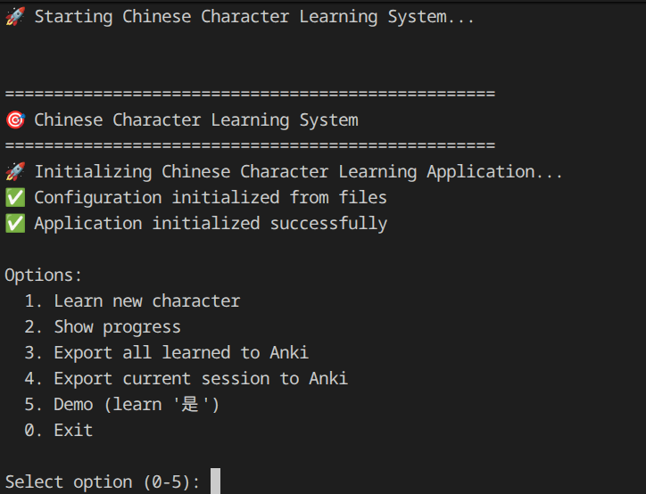
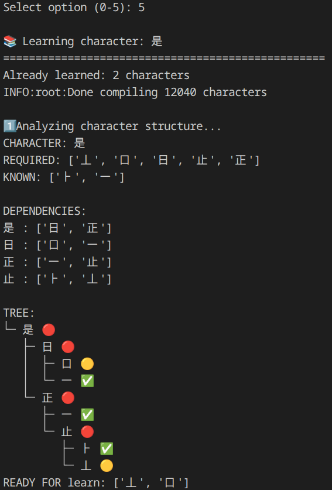

# ChiRy


**ChiRy** is a Python CLI tool that helps beginners learn Chinese characters through decomposition, pinyin mnemonics, AI-assisted explanations, and Anki export. The combinaison of Chinese and Story.

- **Project name + short bio:** Learn Chinese Decomposition, an end-to-end Hanzi learning workflow for decomposition, understanding, and review.
- **Project tech-stack based on:** Python, local JSON persistence, AI providers (OpenRouter + Google Gemini), and GenAnki export.
- **Project demo:** Local CLI demo available by running the app with `./run.sh` (no hosted public demo yet).


## 💡 Overview

Learn Chinese Decomposition guides the learner from a target character to a complete study artifact in one flow:
1. Input a Hanzi target.
2. Compute dependency-aware next learnable character.
3. Generate AI explanations and context examples.
4. Build mnemonic-aware pinyin support.
5. Save progress locally.
6. Export review cards to Anki.


## ✨ Features

- **Dependency-aware decomposition:** Breaks Hanzi into components and determines what can be learned now.
- **AI-assisted learning content:** Generates beginner-friendly explanations and context-rich examples.
- **Pinyin workflow with mnemonic rules:** Supports multiple pronunciations and custom mnemonic mappings.
- **Anki export pipeline:** Creates `.apkg` output for spaced repetition review.
- **Persistent local progress:** Stores learned characters and study artifacts between sessions.
- **Modular architecture:** Organized by concerns (`ai`, `learning`, `pinyin`, `data`, `anki`, `tree`, `main`) with tests.

## Documentation Images

### Start Screen



### Demo




## 👩‍💻 Tech Stack

- **Language:** Python 3.10+
- **Core libraries:** `pandas`, `hanzipy`, `python-dotenv`, `tqdm`
- **AI integration:** `google-genai`, `openai` (for OpenRouter-compatible usage)
- **Flashcard generation:** `genanki`
- **Testing:** `pytest`


## 📖 Sources and external API's

- **OpenRouter API** for LLM-powered content generation.
- **Google Gemini API** for AI-assisted explanation workflows.

### Other Resources

- `data/` folder for tree rules, pinyin rules, learned progress, and corpus mappings.
- `hanzi/` folder for generated character markdown artifacts.
- `anki/` folder for deck package output.

## 📦 Getting Started


### 🚀 Prerequisites

- Python 3.10 or newer
- `python3-venv` package (or equivalent venv support)
- API keys (optional but recommended for full AI functionality):
	- `OPENROUTER_API_KEY`
	- `GOOGLE_API_KEY`

## 🛠️ Installation

1. Clone the repository:

```bash
git clone https://github.com/Hicha-m/learn_chinese_decomposition.git
cd learn_chinese_decomposition
```

2. Run setup script (creates virtualenv and installs dependencies):

```bash
./setup.sh
```


## 📖 Usage


### Environment Configuration

Setup the app:

```bash
./setup.sh
```

configure yours keys :

```env
DIR=./
OPENROUTER_API_KEY=your_openrouter_key
GOOGLE_API_KEY=your_gemini_key
```

### Running the Project

Start the CLI app:

```bash
./run.sh
```

Or by Makefile

```bash
make run
```

### Running Tests

Run the test suite:

```bash
./test.sh
```

## Conclusion

Thanks for checking out Chiry.
If this project helps your Mandarin learning journey, consider starring the repository.
